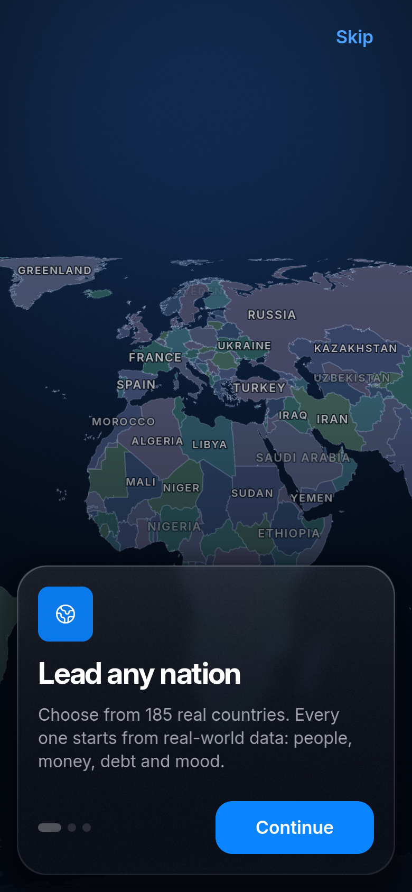
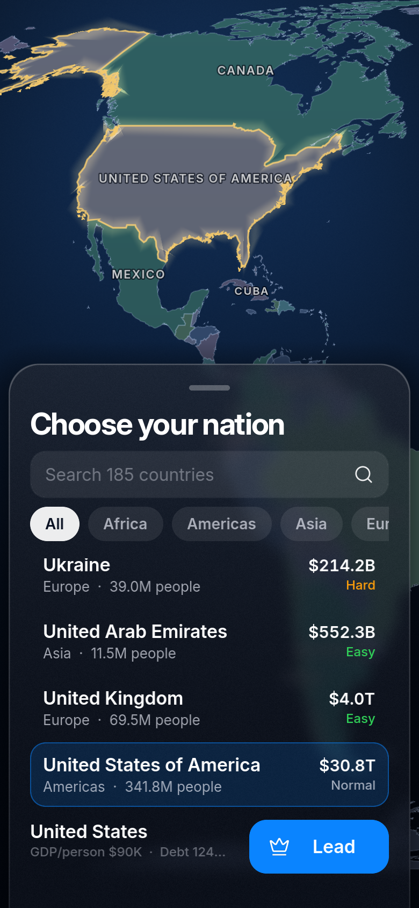
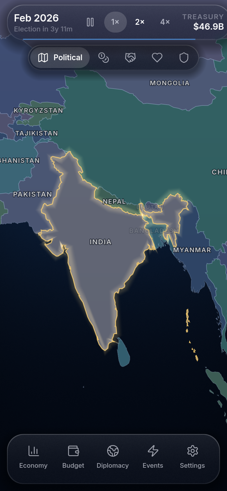
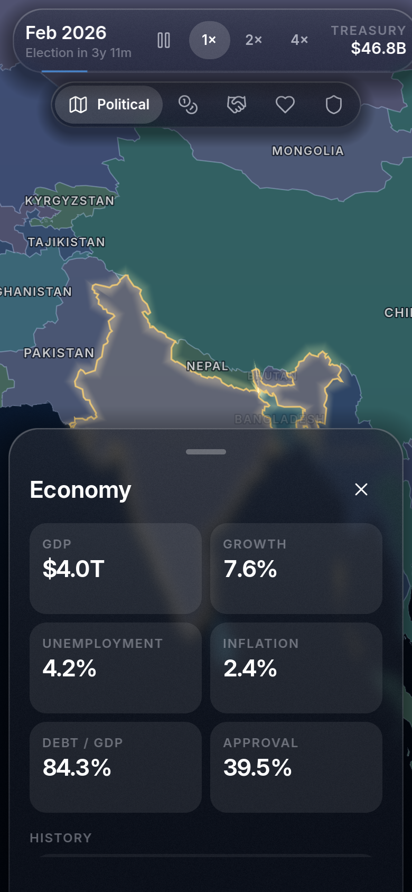
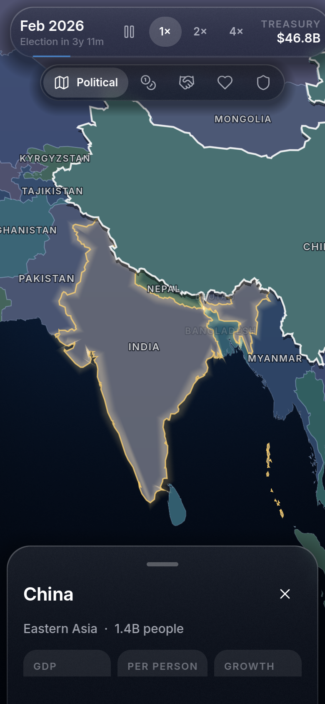

# Arnav Country Simulator

**Lead any real nation on a living world map.**
A calm, realistic country simulator for Android. Every country starts from real 2025 data.

### [Download the latest APK](https://github.com/Arnav-Dugad/arnav-country-simulator/releases/latest)

Android 7.0+ · 64-bit (arm64) · free · no ads · works offline

---

## What it is

Pick any of **185 real countries** and run it month by month. Population, GDP, unemployment,
inflation and government debt all start from World Bank and IMF figures. Then it's up to you:

- **Economy.** Set income and corporate tax, the central-bank interest rate and trade policy.
  Higher taxes raise revenue but slow growth, and tighter money cools inflation but costs jobs.
- **Budget.** Split spending across healthcare, education, infrastructure, military, welfare and
  research. Every choice shows up in growth, happiness and stability.
- **Diplomacy.** Tap any country on the map to sign trade deals, form alliances, send aid or
  impose sanctions. Relations run from −100 to 100 and drift over time.
- **Events.** Recessions, floods, booms, protests, scandals, pandemics and more, each with two
  or three choices that carry real tradeoffs.
- **Elections.** Every four years your approval decides whether you stay in power.
- **A living world.** Every other country is simulated too, so the map changes as you play.

The main screen is a real interactive world map (Natural Earth, Equal Earth projection) with
pinch-zoom, smooth panning and five map modes: Political, Wealth, Relations, Happiness and Stability.

## Screenshots

  
  
  
  
  

## Install on Android

1. On your phone, open **[Releases → Latest](https://github.com/Arnav-Dugad/arnav-country-simulator/releases/latest)**
   and tap the `.apk` file to download it.
2. Open the downloaded file. If Android asks, allow your browser or file manager to
   **Install unknown apps** (Settings → Apps → Special access → Install unknown apps).
3. Tap **Install**, then open **Arnav Country Simulator**.

**Updates:** the app checks for new versions on launch. You can also go to Settings → *Check for updates*.
Tap **Update now** and the new version installs over the old one, keeping your saves.

## Cloud saves (optional)

You can play as a guest with no sign-up, or add an email account to keep your saves on any device.
Saves are always written to the phone first and sync when you're back online. Cloud saves use
Firebase (Authentication + Cloud Firestore) on the free Spark plan.

## Building from source

- Godot **4.7.2** (standard build, GDScript only), Compatibility renderer.
- Android export uses the Gradle build: JDK 17, Android SDK (platform 36, build-tools 36.1.0).
- See [`CLAUDE.md`](CLAUDE.md) for the project structure, conventions and dev commands,
  and [`data/SOURCES.md`](data/SOURCES.md) for how the map and data are generated.
- Releases are built by GitHub Actions when a `vX.Y.Z` tag is pushed
  ([`.github/workflows/release.yml`](.github/workflows/release.yml)).

## Credits & licenses

| | Source | License |
|---|---|---|
| Country borders | [Natural Earth](https://www.naturalearthdata.com/) 1:50m Admin 0, v5.1.2 | Public domain |
| Economic data | [World Bank](https://data.worldbank.org/) WDI & WGI | CC BY 4.0 |
| Debt & fiscal data | [IMF](https://www.imf.org/external/datamapper/) World Economic Outlook | Free with attribution |
| Font | [Inter](https://rsms.me/inter/) by Rasmus Andersson | SIL Open Font License 1.1 |
| Icons | [Lucide](https://lucide.dev/) | ISC |
| Sound & music | Original, synthesized in-house (`tools/make_audio.py`) | Same as the game |
| Flags | [flag-icons](https://github.com/lipis/flag-icons) | MIT |
| Engine | [Godot Engine](https://godotengine.org/) | MIT |

Starting values for a few small states use regional estimates; the game marks them as estimated.
The simulation is a game model, not a forecast.

© 2026 Arnav Dugad. Game code and art in this repository are by the author.
